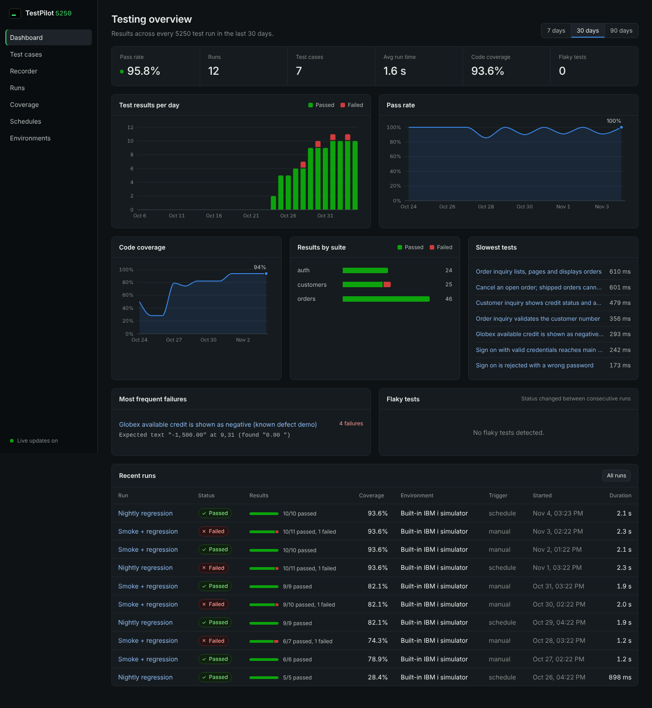
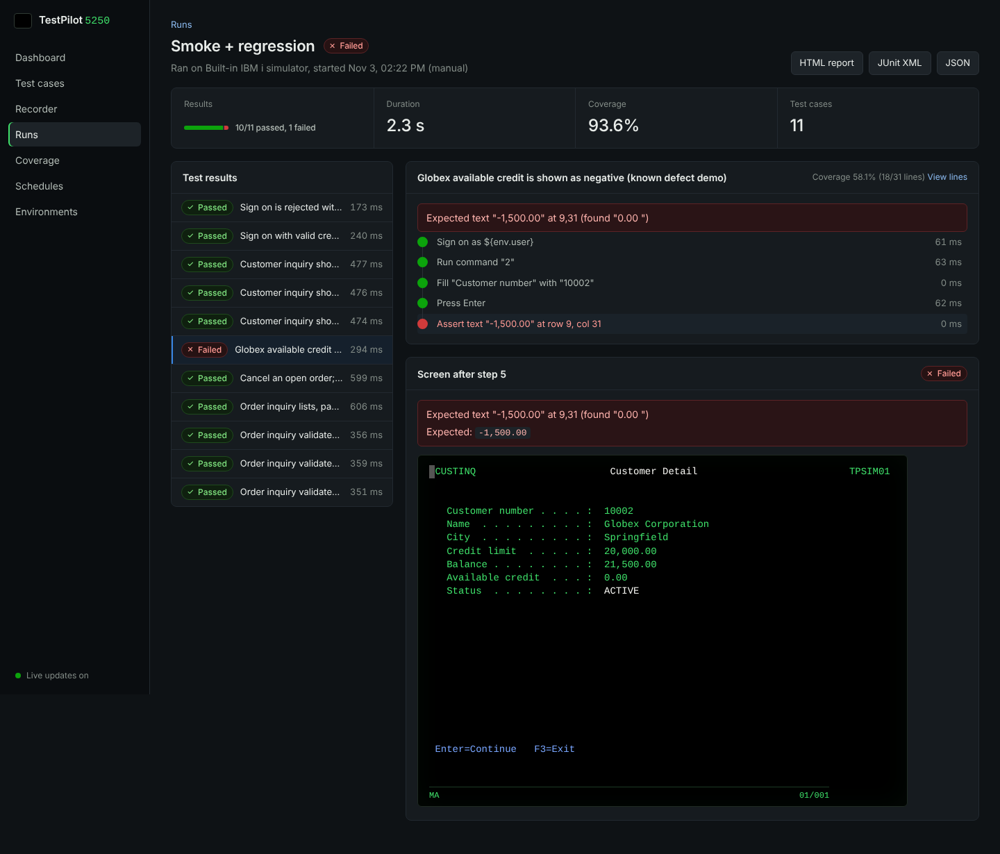
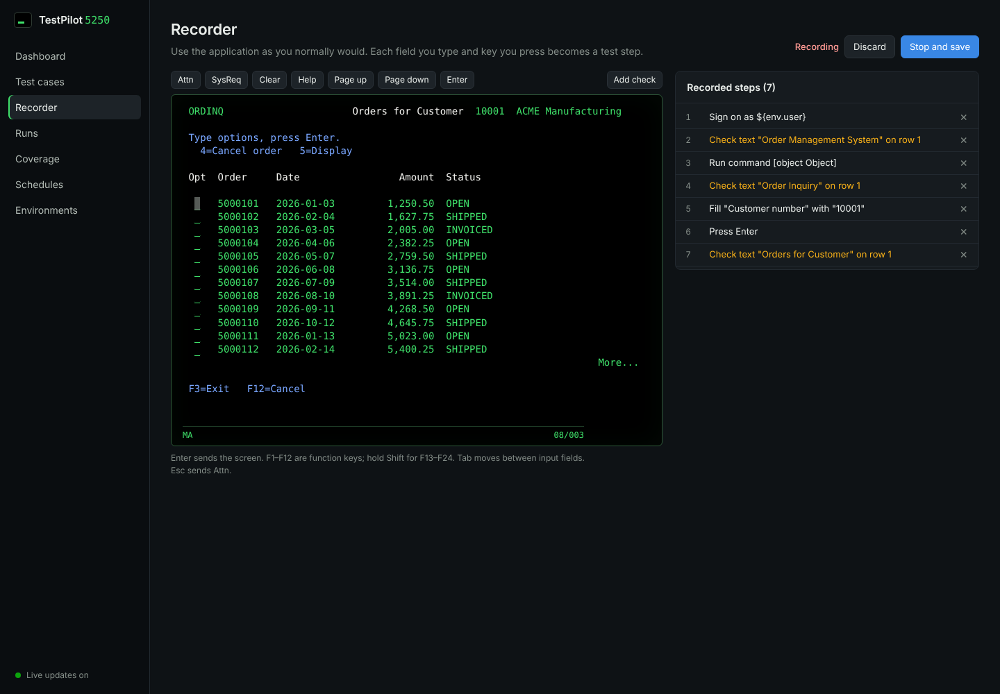
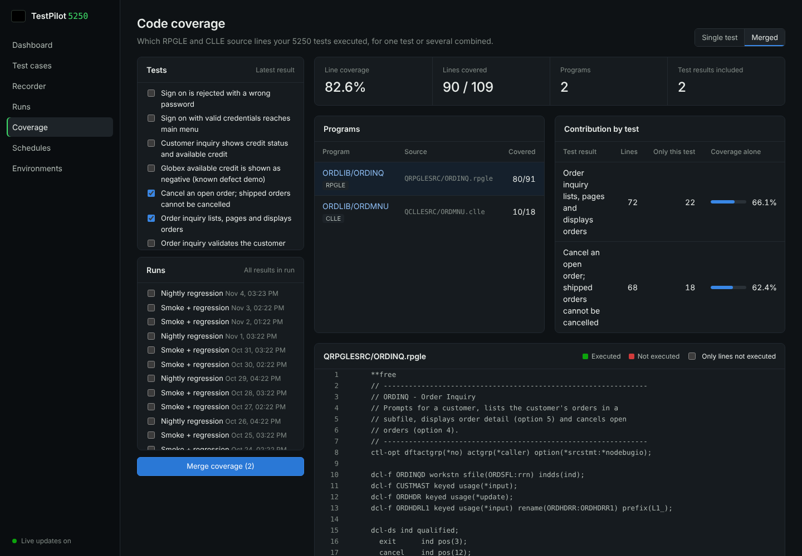

# TestPilot 5250

Automated end-to-end testing for IBM i **5250 green-screen** applications (RPGLE, CLLE, DDS).
You can record tests or write them as YAML or JavaScript. They play back headlessly over TN5250. Every
run produces pass/fail results and reports, plus line-level **code coverage** of the RPGLE/CLLE source. A
React dashboard tracks the whole testing cycle.

## Screenshots

| Dashboard | Run detail |
|:---------:|:----------:|
|  |  |

| Recorder | Coverage |
|:--------:|:--------:|
|  |  |

```
┌────────────── Browser (React dashboard) ──────────────┐
│ Dashboard · Tests · Recorder (live 5250) · Runs ·      │
│ Coverage viewer · Schedules · Environments             │
└───────────────▲──────────────────────▲─────────────────┘
          REST /api             WebSocket /ws (live run events, recorder)
┌───────────────┴──────────────────────┴─────────────────┐
│ @tp5250/server  Node.js · SQLite (node:sqlite) · cron  │
├────────────────────────────────────────────────────────┤
│ @tp5250/core    DSL · runner · recorder · coverage ·   │
│                 HTML/JUnit/JSON reports · CLI (tp5250) │
├────────────────────────────────────────────────────────┤
│ @tp5250/tn5250  Telnet/TN5250 client · 5250 data       │
│                 stream · screen/field model · EBCDIC   │
└───────────────┬────────────────────────────────────────┘
                │ TN5250 (23 / 992 TLS)          coverage: QDEVTOOLS/CODECOV → .cczip (SFTP)
        ┌───────┴────────┐
        │  IBM i         │   or  @tp5250/simulator (bundled demo IBM i + sample app)
        └────────────────┘
```

## MVP criteria → where they live

| # | Requirement | Implementation |
|---|---|---|
| 1 | Recording & playback | **Recorder** page: a live 5250 terminal in the browser. Every field you change and every key you press becomes a step. The recorder adds checks for the screen title and message line, lets you add your own checks by selecting text, and saves the test as YAML. Playback runs headlessly through `@tp5250/tn5250`. Passwords are always recorded as `${env.password}`. |
| 2 | Pass/fail results & reports | Per step: status, duration, error, expected value, and the **5250 screen at that step**. Per run: an **HTML** report, **JUnit XML** (for Jenkins, GitHub, Azure DevOps or GitLab) and **JSON**, available from the UI, the API (`/api/runs/:id/report.*`) and the CLI (`--report dir`). |
| 3 | Native 5250 | A TN5250 protocol engine written from scratch: telnet negotiation (TERMINAL-TYPE `IBM-3179-2`, EOR, BINARY, NEW-ENVIRON device name), GDS records, WTD orders (SBA/SF/IC/RA/EA/SOH/TD…), FFW/FCW, Read MDT/Input/Immediate/Screen, Save/Restore Screen, Write Error Code, 5250 Query reply, CP037 EBCDIC, TLS. |
| 4 | Code coverage | Line coverage per test case and **merged** across any set of tests or runs. Shows executable lines, covered lines and percentage per program, plus a source viewer with hit counts and "covered by" for each line. Two adapters: **CODECOV** for a real IBM i (wraps `CALL` in `QDEVTOOLS/CODECOV … CCVIEW(*SOURCE)` and fetches the `.cczip`), and **simulator**. |
| 5 | Automated test scripts | YAML DSL (15 actions, variables, captured values, data-driven CSV/JSON) and a JavaScript API (`t.fill`, `t.press`, `t.expect`, `t.step`…). Runs from the CLI with parallel sessions, retries and tag/suite filters, from the dashboard, or on a cron schedule. |
| 6 | Dashboards (Node.js + React) | KPIs (pass rate, runs, tests, average duration, coverage, flaky tests), results per day, pass-rate and coverage trends, results by suite, most frequent failures, flaky and slowest tests, and recent runs. Updates live over WebSocket. |

### Extra features for a healthy MVP
- **Bundled IBM i simulator**: a TN5250 server running a sample order-management app (sign-on, CLLE menu, RPGLE order inquiry with subfile, paging, detail and cancel, plus customer inquiry). Its execution maps to the real RPGLE/CLLE sources in `samples/ibmi`, so coverage is meaningful. You can demo and develop without an IBM i.
- **Data-driven tests** (CSV/JSON/inline): each data row is reported as its own iteration.
- **Environments** (dev/test/QA LPARs), with variables and `${secrets.X}` taken from process env.
- **Parallel execution**: one 5250 session per test, with unique device names.
- **Retries and flaky-test detection.**
- **Scheduler**: cron-based nightly regressions.
- **CI-ready CLI**: exit codes, JUnit output, and `--server` to publish CLI runs to the dashboard.
- **Live run monitoring**: steps stream to the UI as they execute.
- **Script validation** in the editor and from the CLI (`tp5250 validate`).

## Quick start

Requires Node.js ≥ 22.5 (uses the built-in `node:sqlite`).

```bash
npm install            # workspace packages (ws, yaml; optional ssh2)
npm run web:install    # dashboard deps (react, d3-scale, d3-shape, esbuild)
npm run web:build

npm run demo           # server + simulator, seeds 12 real runs as history → http://localhost:4250
# or
npm run server         # server + simulator with sample tests, empty history
```

Sign on to the simulator as `TESTER` / `TESTER1` (on the Recorder page, choose "Built-in IBM i simulator").

### CLI

```bash
npm run simulator &                                   # standalone simulator on :2323 (coverage API :2324)
export TP_PASSWORD=TESTER1
node packages/core/src/cli.js run samples/tests --env samples/env.simulator.json --report out/reports
node packages/core/src/cli.js run samples/tests --tags smoke --concurrency 4 --retries 1 --server http://localhost:4250
node packages/core/src/cli.js validate samples/tests
npm test                                              # unit + end-to-end tests
```

## Writing tests
See **[docs/SCRIPTING.md](docs/SCRIPTING.md)**. A short example:

```yaml
name: Order inquiry lists orders
suite: orders
tags: [smoke]
coverage: { programs: [ORDINQ] }
steps:
  - signon: {}                                     # uses env user/password
  - command: "CALL ORDINQ"                         # types on the command line + Enter
  - fill: { label: Customer number, value: "10001" }
  - press: Enter
  - assertText: { text: "ACME Manufacturing", row: 1 }
  - assertText: { text: "More...", row: 20 }
  - press: F3
```

## Running against a real IBM i
See **[docs/IBMI-SETUP.md](docs/IBMI-SETUP.md)**. It covers TN5250/TLS, device names, CODECOV prerequisites (5770WDS option 60 / PTFs), compiling with `DBGVIEW(*SOURCE)`, and SFTP retrieval of the `.cczip`.

## Project layout
```
packages/tn5250     TN5250 protocol + headless emulator (no dependencies)
packages/core       DSL, executor, runner, recorder, coverage, reports, CLI
packages/server     REST + WebSocket API, SQLite store, scheduler, dashboard aggregates
packages/simulator  Demo IBM i: TN5250 server + sample app + coverage API
web/                React dashboard (esbuild)
samples/ibmi        Sample RPGLE / CLLE / DDS sources (what the simulator "runs")
samples/tests       Sample YAML + JS tests, samples/data CSV, env files
docs/               API contract, scripting reference, IBM i setup
```

## Known limitations / next steps
- **No user authentication on the dashboard yet.** Run it on a trusted network, or put it behind a reverse proxy with SSO. Environment passwords are stored in SQLite without encryption and are masked in the API. Adding RBAC and a secrets vault (or env-only secrets) comes next.
- **The CODECOV `.cczip` parser is best-effort.** IBM does not document the layout. The adapter handles the invocation, the result-file message and SFTP retrieval end to end, and parses Cobertura-style and generic line/hit XML. Validate it against a `.cczip` from your system, and adjust `parseCczip()` in `packages/core/src/coverage.js` if needed. The CODECOV `TESTID` keyword should also be checked on your release. Menu options that call a program without a `CALL` command need either a `CALL` in the test or a coverage wrapper program.
- Screen size is 24×80 (`*DS3`). 27×132 (`*DS4`), DBCS, and 5250 GUI structured fields (windows, push buttons) are parsed past but not modelled.
- In the browser terminal, input fields longer than one row are clipped to the first row. The headless engine handles the full length.
- Coverage % is computed over the programs listed in each test's `coverage.programs`, or all instrumented programs if none are listed.
